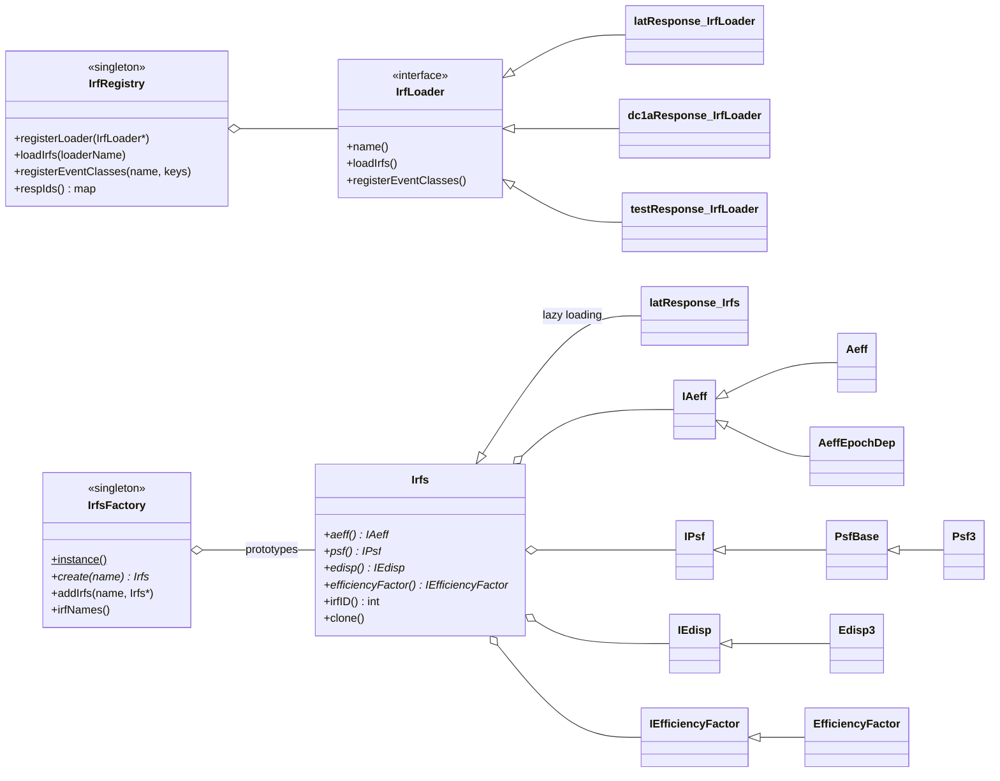

# irfs Architecture

**irfs** is a container package. One git repository holds several
sub-libraries, the `gtirfs` tool, a SWIG module, and the LAT **CALDB**
itself (the IRF FITS files and their index). Together they answer one
question for the analysis tools: *given an IRF name such as
`P8R3_SOURCE_V3` and an event type such as `PSF2`, what are the effective
area, PSF, energy dispersion and livetime-efficiency correction at a given
energy, inclination and azimuth?*

This README is the overview. The details are in the topic files:

| Topic file | Covers |
|------------|--------|
| [irf-interface.md](irf-interface.md) | `irfInterface`: the abstract `Irfs`/`IAeff`/`IPsf`/`IEdisp`/`IEfficiencyFactor` classes, `IrfsFactory`, `IrfRegistry`, `AcceptanceCone`, and the generic numerics in the base classes. |
| [loading-and-names.md](loading-and-names.md) | `irfLoader` and `irfUtil`: what happens when the library loads, `Loader::go()`, how IRF names and event types turn into factory keys, the `respIds` map, and how Likelihood/dataSubselector resolve `irfs=CALDB`. |
| [caldb.md](caldb.md) | The bundled CALDB: directory layout, `caldb.config`, `caldb.indx`, `irf_index.fits`, the valid-selection tables, and the maintenance scripts. |
| [lat-response.md](lat-response.md) | `latResponse`: the real LAT implementation. FITS tables and interpolation, `Aeff` with phi dependence, `EfficiencyFactor`, `Psf3`, `Edisp3`, version dispatch, epochs and caches. |

The top-level `src/mainpage.h` is a placeholder, and `doc/release.notes`
and the sub-package release notes stop around 2017 (P8R3 `_V3` arrived
later). Treat the code and the CALDB index as the source of truth.

## Purpose and scope

**Does:**
- Define the abstract IRF interface used by every science tool
  (`irfInterface`).
- Implement the LAT IRFs for Pass 7 and Pass 8 (P8R2, P8R3) from the CALDB
  FITS files (`latResponse`): effective area with phi modulation, PSF
  (King-function core + tail), energy dispersion (two-component
  "Thibaut" function with scaling), livetime-fraction efficiency
  corrections, and multi-epoch IRFs.
- Discover the available IRFs at load time from `caldb.indx`, and the
  event-type bit layout from `irf_index.fits` (`irfUtil::EventTypeMapper`).
- Register every IRF/event-type combination in a factory, and publish a
  `respIds` map from user-facing names (`P8R3_SOURCE_V3`,
  `P8R3_SOURCE_V3 (PSF)`, `P8R3_SOURCE_V3::PSF0`) to factory keys
  (`irfLoader`).
- Ship the LAT CALDB tree (`caldb/CALDB`, about 48 MB) and install it as
  `$FERMI_DIR/data/caldb`.
- Provide a few analytic test responses (`DC1A`, `TEST`) used by unit
  tests and as Python defaults.
- Print the available IRF names (`gtirfs`).
- Expose the interface and the Pass 8 classes to Python (`pyIrfLoader`).

**Does not:**
- Decide which IRF a given data file needs. Mapping `irfs=CALDB` plus the
  file's DSS keywords and `evtype` to a name happens in `Likelihood`
  (`AppHelpers`) and `dataSubselector` (`Cuts::CALDB_implied_irfs`). See
  [loading-and-names.md](loading-and-names.md#resolving-irfscaldb-in-consumers).
- Compute exposure, livetime cubes or source maps. `Likelihood` does that
  using these IRFs.
- Generate IRFs from Monte Carlo. The old `handoff_response` code that did
  this is in the repo but not built.
- Use a full HEASoft CALDB installation. It uses its own copy of the
  HEASoft `HDgtcalf` lookup routine and its own bundled CALDB.

## Position in the system

| Direction | Package | Why |
|-----------|---------|-----|
| Depends on | `tip` | Reads every IRF FITS table, `caldb.indx`, `irf_index.fits` and FT2 files (for `IEfficiencyFactor::readFt2File`). |
| Depends on | `astro` | `SkyDir` in all direction-based interfaces; `JulianDate` for epoch start times. |
| Depends on | `st_facilities` | `Environment` (CALDB variables), `GaussianQuadrature`/`RootFinder` (PSF and energy-dispersion integrals), `Util::readLines`/`file_ok`, `Env`. Linked `PUBLIC` by `irfInterface`, so every client inherits it. |
| Depends on | `facilities` | `commonUtilities::joinPath`/`setEnvironment`, `Util::stringTokenize`/`expandEnvVar`. Linked directly only by `irfLoader`; the other sub-libraries get it through `st_facilities`. |
| Depends on | `st_app`, `st_stream` | `gtirfs` (application framework, output). `st_stream` is also used for warnings in `latResponse`. `irfLoader` links both `PUBLIC`, although the library sources need neither; only the `gtirfs` executable does. |
| Depends on | cfitsio | `irfUtil`'s copy of `HDgtcalf` calls cfitsio directly. |
| Depends on | CLHEP | Random numbers (`IPsf::appDir`, `IEdisp::appEnergy`) and 3-vectors. |
| Test only | CppUnit | `test_irfInterface`, `test_irfLoader`, `test_latResponse`, `test_testResponse`. |
| Used by | `Likelihood` | The main client. `irfLoader::Loader_go()`/`Loader_respIds()`, `IrfsFactory::create`, and through `Irfs`: `IAeff` (including `setPhiDependence`), `IPsf` (`value`, `angularIntegral` with `AcceptanceCone`s), `IEdisp`, `IEfficiencyFactor::value`, `Irfs::irfID()` as the event-type key. |
| Used by | `pyLikelihood` | SWIG-wraps only `irfInterface/IEfficiencyFactor.h`. `irfLoader/Loader.h`, `IrfsFactory.h` and `Irfs.h` are `#include`d for its C++ helpers but not wrapped, so Python has no `IrfsFactory`, `Irfs` or `Loader` (see `src/pyLikelihood/doc/architecture/swig-interface.md`). |
| Used by | `dataSubselector` | Only `irfUtil::EventTypeMapper` (in `Cuts::append_event_type_partition`). It also reads `irf_index.fits` and `valid_ev*_selections.txt` from the CALDB itself. It links `irfLoader` and `irfInterface` but uses neither. |
| Used by | `observationSim` | `gtobssim`: `Loader::go()`/`respIds()`, `IrfsFactory`, `Irfs` (sampling via `IPsf::appDir`, `IEdisp::appEnergy`), and `irfUtil::EventTypeMapper`. |
| Used by | `rspgen` | `Loader`, `IrfsFactory`, `Irfs`, `IAeff`, `IPsf`, `IEdisp::integral`. |
| Used by | `pyExposure` | `Loader`, `IrfsFactory`, `IAeff`, `IPsf::angularIntegral`, `IEfficiencyFactor`. |
| Used by | `SolarSystemTools` | `Irfs`, `IAeff`, `IEfficiencyFactor`, reached through `Likelihood::ResponseFunctions`. Links `irfLoader`. |
| Link only | `BayesianBlocks` | Links `irfInterface` `PUBLIC`; no source uses it. |
| Link only | `map_tools` | Links `irfLoader` `PUBLIC`. Only `src/exposure_map/exposure_map.cxx` uses irfs (`Loader`, `IrfsFactory`, `IAeff::setPhiDependence`), and that file is not built. |

Notes:
- `skymaps` (`EffectiveArea.cxx`) and `st_facilities`
  (`FitsTable`/`Bilinear`) contain **copies** of `latResponse` code, not
  uses of it. A fix in one copy does not reach the others.
- Nothing in the repo imports the `pyIrfLoader` Python module except its
  own example scripts.
- `observationSim/python/observationSim.i` includes `latResponse/Irfs.h`,
  which is not a public header (the class is in `latResponse/src/`).
  `Likelihood/src/old_tests/main.cxx` includes a `latResponse/IrfsFactory.h`
  that no longer exists. Neither file is built.

### Sub-libraries and what is built

| Directory | CMake target | Built? | Role |
|-----------|--------------|--------|------|
| `irfInterface` | `irfInterface` (SHARED) | yes | Abstract interface and registries. The only sub-library most clients include. |
| `irfUtil` | `irfUtil` (STATIC) | yes | CALDB lookup (`HdCaldb` over vendored `HDgtcalf`), `IrfHdus`, `EventTypeMapper`, `Util`. |
| `latResponse` | `latResponse` (STATIC) | yes | The LAT IRF implementation. |
| `irfLoader` | `irfLoader` (SHARED), `gtirfs` | yes | Static registration of loaders, `Loader::go()`, `respIds()`. |
| `pyIrfLoader` | `pyIrfLoader` (SWIG module) | yes | Python bindings. |
| `dc1aResponse` | SHARED | yes | Analytic `DC1A` responses; registered. Used by Likelihood tests and as the `irfs` default in `pyLikelihood`'s `UnbinnedAnalysis`/`BinnedAnalysis` parameter dictionaries. |
| `testResponse` | SHARED | yes | Analytic `TEST` responses (`testIrfs::Front/Back`); registered. |
| `dc1Response`, `dc2Response` | SHARED | yes, but **dead** | Built, installed and linked into `irfLoader`, but `Registrar` never registers them, so their IRFs (`DC1`, `DC2`) cannot be loaded. They also need CALDB entries that no longer exist. |
| `caldb` | install only | — | Installs `caldb/CALDB/` to `${FERMI_INSTALL_DATADIR}/caldb` (`share/fermitools/data/caldb`). |
| `g25Response` | — | no | GLAST25-era responses. SCons/CMT only. |
| `handoff_response` | — | no | IRF generation from Monte Carlo (needs ROOT), the `make_fits` converter (`pfiles/make_fits.par`), and Python setup scripts. Reference only. |

About 10,300 lines of C/C++ make up the libraries that matter (including
about 1,400 lines of vendored `HDgtcalf` C). The built-but-legacy
`dc1*`/`dc2`/`testResponse` add about 3,500 lines. The unbuilt
`g25Response`/`handoff_response` are another 10,000 lines.

## Key abstractions



| Type | Where | Role |
|------|-------|------|
| `irfInterface::Irfs` | `irfInterface/Irfs.h` | Holds one `IAeff`, `IPsf`, `IEdisp` and optional `IEfficiencyFactor` for one IRF + event type. `irfID()` is the event-type **bit position** (0=FRONT, 1=BACK, 2–5=PSF0–3, 6–9=EDISP0–3). |
| `irfInterface::IrfsFactory` | `IrfsFactory.h` | Global prototype map `"P8R3_SOURCE_V3::PSF2"` → `Irfs*`. `create()` returns a **new clone** that the caller owns. |
| `irfInterface::IrfRegistry` | `IrfRegistry.h` | Global map of loaders by name (`LATRESPONSE`, `DC1A`, `TEST`) and the `respIds` map from user-facing names to lists of factory keys. |
| `irfLoader::Loader` | `irfLoader/Loader.h` | Static facade. A static `Registrar` registers the loaders when `libirfLoader` loads; `go()` asks each loader to fill the factory and the `respIds` map. |
| `latResponse::IrfLoader` | `latResponse/IrfLoader.h` | Reads `caldb.indx` to list the IRF names, uses `EventTypeMapper` for event types, and adds one lazy `latResponse::Irfs` per (IRF, event type). Also the factory for the concrete `Aeff`/`Psf*`/`Edisp*`/`EfficiencyFactor` classes, chosen by `PSFVER`/`EDISPVER` and by number of epochs. |
| `irfUtil::EventTypeMapper` | `irfUtil/EventTypeMapper.h` | Singleton built from `irf_index.fits`: for each IRF name, event type → (bit position, partition `none`/`PSF`/`EDISP`). |
| `irfUtil::IrfHdus` | `irfUtil/IrfHdus.h` | For one IRF + event type + component, the list of (file, HDU number) pairs, one per epoch, found through `HdCaldb`. |
| `irfUtil::HdCaldb` | `irfUtil/HdCaldb.h` | C++ wrapper over the vendored HEASoft `HDgtcalf` CALDB query. |
| `irfInterface::AcceptanceCone` | `AcceptanceCone.h` | A sky cone (centre, radius in degrees), used to describe the ROI for PSF integrals. |

## Data flow and control flow

A typical Likelihood tool run:

```
process start: libirfLoader.so loads
  static Loader::s_registrar = new Registrar()          // irfLoader/src/Loader.cxx
    st_facilities::Environment::instance()              // setupEnvironment(); fills CALDB* only if unset
    IrfRegistry::registerLoader(new dc1aResponse::IrfLoader)
    IrfRegistry::registerLoader(new latResponse::IrfLoader)
      read $CALDBCONFIG → path of caldb.indx → read CIF → IRF names (CAL_DATE > 2007-01-01)
      new HdCaldb → checks $CALDBALIAS and $CALDBCONFIG exist
    IrfRegistry::registerLoader(new testResponse::IrfLoader)

Likelihood::AppHelpers → resolve "CALDB" / evtype → e.g. "P8R3_SOURCE_V3 (PSF)"
ResponseFunctions::load(name, ...)
  irfLoader::Loader_go()                                // for each loader:
    latResponse::IrfLoader::loadIrfs()                  //  EventTypeMapper (reads irf_index.fits once)
      IrfsFactory::addIrfs("P8R3_SOURCE_V3::PSF0", new latResponse::Irfs(...))   // no files read yet
      ... for every IRF name × allowed event type
    latResponse::IrfLoader::registerEventClasses()      //  respIds["P8R3_SOURCE_V3 (PSF)"] = {::PSF0..::PSF3}
  for key in respIds[name]:  irfs = IrfsFactory::create(key)   // clone of the empty prototype
     keep it if irfs->irfID() is in the selected event types

first irfs->aeff() / psf() / edisp() / efficiencyFactor()
  IrfHdus::aeff|psf|edisp(name, evtype) → HdCaldb::getFiles → HDgtcalf scans caldb.indx
  latResponse::IrfLoader::aeff|psf|edisp(hdus) → Aeff / Psf3 / Edisp3 (or *EpochDep)
  → reads the FITS tables through tip; Psf3 normalizes its parameters
```

`gtirfs` runs `Loader::go()` and prints every `respIds` key and its
components. Keys containing `TEST`, `DC1`, `DC2`, `G25`, `HANDOFF`,
`P5_v0` or `Pass4` are printed only at `chatter` ≥ 3.

## Public interfaces

### C++ API

Most clients need only:

```cpp
#include "irfLoader/Loader.h"
#include "irfInterface/IrfsFactory.h"
#include "irfInterface/Irfs.h"

irfLoader::Loader::go();                           // or irfLoader::Loader_go()
const auto & ids = irfLoader::Loader::respIds();   // name → factory keys
irfInterface::IrfsFactory * f = irfInterface::IrfsFactory::instance();
std::unique_ptr<irfInterface::Irfs> irfs(f->create("P8R3_SOURCE_V3::FRONT"));
double aeff_cm2 = irfs->aeff()->value(energy_MeV, theta_deg, phi_deg, met);
double psf_sr   = irfs->psf()->value(sep_deg, energy_MeV, theta_deg, phi_deg, met);
double edisp    = irfs->edisp()->value(appE_MeV, energy_MeV, theta_deg, phi_deg, met);
```

Units: energies in MeV, angles in degrees, effective area in cm²,
PSF density per steradian, energy dispersion per MeV of measured energy,
times in MET seconds.

| Header | Used by |
|--------|---------|
| `irfInterface/Irfs.h`, `IrfsFactory.h` | Likelihood, pyLikelihood, observationSim, rspgen, pyExposure, SolarSystemTools (via Likelihood) |
| `irfInterface/IAeff.h`, `IPsf.h`, `IEdisp.h` | the same clients, mostly reached through `Irfs.h` |
| `irfInterface/IEfficiencyFactor.h` | Likelihood, pyLikelihood, pyExposure, SolarSystemTools |
| `irfInterface/AcceptanceCone.h` | Likelihood (ROI PSF integrals) |
| `irfLoader/Loader.h` | Likelihood, pyLikelihood, observationSim, rspgen, pyExposure |
| `irfUtil/EventTypeMapper.h` | dataSubselector, observationSim |
| `irfInterface/IrfRegistry.h`, `IrfLoader.h` | Only inside irfs (and tests). Needed to add a new loader. |
| `latResponse/*.h` (`Aeff`, `Psf3`, `Edisp3`, `FitsTable`, `ParTables`, `Bilinear`, `EdispInterpolator`, `PsfBase`, `IrfLoader`) | Installed and wrapped by `pyIrfLoader`; no other package includes them. |

Headers of all sub-libraries are installed to `include/<sublib>/`,
including the legacy `dc1Response`, `dc1aResponse`, `dc2Response` and
`testResponse`.

### Applications

| Tool | Built | Par file | Notes |
|------|-------|----------|-------|
| `gtirfs` | yes (`irfLoader`) | `irfLoader/pfiles/gtirfs.par` | Lists IRF names. Only standard hidden parameters. Help text is in `fermitools-fhelp` (`gtirfs.txt`). The file comment in `gtirfs.cxx` ("Apply event by event energy correction") is copied from `gtecorrect` and is wrong. |
| `gtecorrect` | **no** | `irfLoader/pfiles/gtecorrect.par` (installed) | Old per-event energy correction for `DC1A`/`DC2`/`HANDOFF`. Source only. |
| `combine_irfs` | **no** | `latResponse/pfiles/combine_irfs.par` (installed) | Old helper that merged per-class IRF FITS files. Source only. |
| `make_fits` | **no** | `handoff_response/pfiles/make_fits.par` (not installed) | Part of unbuilt `handoff_response`. |

The two installed par files for unbuilt tools are dead files in
`syspfiles`. `gtirfs` follows the `st_app` conventions (see
`src/st_app/doc/architecture/`).

### Python

`pyIrfLoader` (SWIG, `pyIrfLoader/src/pyIrfLoader.i`) wraps
`irfInterface` (`IAeff`, `IPsf`, `IEdisp`, `IEfficiencyFactor`, `Irfs`,
`IrfsFactory`, `AcceptanceCone`), `irfLoader::Loader`, the Pass 8
`latResponse` classes (`Aeff`, `Psf3`, `Edisp3`, `ParTables`, `Bilinear`,
`EdispInterpolator`, `PsfBase`), `astro::SkyDir`/`SkyProj`/`HealpixProj`
and CLHEP `Hep3Vector`. Extras added in the `.i` file:
- `IPsf.app_dir(energy, inclination)` returns (separation, random phi).
- Vectorized `IPsf.value` and `IEdisp.value` over a list of separations or
  measured energies.
- `IrfsFactory.irfNames()`.
- `Aeff.cast`, `Psf3.cast`, `Edisp3.cast` downcast from the interfaces.
- C++ exceptions become Python `RuntimeError`.

```python
import pyIrfLoader
pyIrfLoader.Loader_go()
f = pyIrfLoader.IrfsFactory.instance()
irfs = f.create("P8R3_SOURCE_V3::PSF3")
psf3 = pyIrfLoader.Psf3.cast(irfs.psf())
```

`pyIrfLoader/src/pyIrfLoader.in` is the older SCons template and is not
used. The installed scripts `plot_irfs.py`, `four_panel.py` and
`psf_tests.py` import `numarray` and `hippoplotter`, so they **do not run**
in a current environment. `irfLoader/python/` (`psf_tests.py`, `setup.py`)
is not installed.

### Environment variables

Conda activation sets the `CALDB*` variables (see "Runtime environment"
in ScienceTools' `docs/architecture/README.md`).

| Variable | Read by | Effect |
|----------|---------|--------|
| `CALDB` | `latResponse::IrfLoader`, `EventTypeMapper`, `HDgtcalf` (via `CALDBCONFIG`), `Registrar` | Root of the CALDB. `irf_index.fits` is read from the hard-coded `$CALDB/data/glast/lat/bcf/`. Required. |
| `CALDBCONFIG` | `latResponse::IrfLoader::find_cif`, `HDgtcalf`, `HdCaldb` (existence check) | `caldb.config`; the `GLAST LAT` line gives the path of `caldb.indx`. Required. |
| `CALDBALIAS` | `HdCaldb` constructor | Only checked for existence (`file_ok`). Required. |
| `CUSTOM_IRF_DIR`, `CUSTOM_IRF_NAMES` | `latResponse::IrfLoader::readCustomIrfNames` | Read at load time, but `loadCustomIrfs()` is entirely commented out, so **custom IRFs are not supported**. Setting `CUSTOM_IRF_DIR` without `CUSTOM_IRF_NAMES` throws during static initialization. |
| `OMIT_EFFICIENCY_FACTOR` | `IEfficiencyFactor::value(energy, ltfrac, met)` | If set, the averaged efficiency factor is 1. The 4-argument `value(…, front, met)` ignores it. |
| `EFFICIENCY_PAR_FILE` | `latResponse::EfficiencyFactor()` default constructor | Reads efficiency parameters from a text or FITS file. The CALDB loading path does not use this constructor. |
| `DISABLE_EDISP_INTERP` | `Edisp3::value`, `Edisp2::value` | Use the nearest-bin parameters instead of the `EdispInterpolator`. |
| `USE_OLD_IPSF_SAMPLER` | `IPsf::appDir` | Use the older trapezoid sampler for PSF draws. |
| `CALIB_DIR` | `irfLoader::Loader::go(name)` | Needed only for a loader named `EGRET`, which no longer exists. |

### File formats

- **Read:** `caldb.config` (text), `caldb.indx` (`CIF` table),
  `irf_index.fits` (`BITMASK_MAPPING`, `EVENT_TYPE_MAPPING`), and the IRF
  FITS files (`EFFECTIVE AREA*`, `PHI_DEPENDENCE*`, `EFFICIENCY_PARAMS*`,
  `RPSF*`, `PSF_SCALING_PARAMS*`, `ENERGY DISPERSION*`,
  `EDISP_SCALING_PARAMS*`). FT2 `SC_DATA` (`START`, `STOP`, `LIVETIME`)
  through `IEfficiencyFactor::readFt2File`. Details in
  [caldb.md](caldb.md) and [lat-response.md](lat-response.md).
- **Written:** nothing (the unbuilt `combine_irfs` and `make_fits` wrote
  IRF files).

## Build and test

- **Targets:** see the sub-library table above. `irfLoader` adds
  `TRAP_FPE` as a `PUBLIC` compile definition on non-Apple systems (the
  top-level `CMakeLists.txt` also defines it globally).
- **Install:**
  - headers of every built sub-library go to `include/<sublib>`
  - `caldb/CALDB/` goes to `${FERMI_INSTALL_DATADIR}/caldb`
    (`share/fermitools/data/caldb`), which is where activation points
    `CALDB`
  - `latResponse/data/` (epoch test files) goes to
    `${FERMI_INSTALL_REFDATADIR}/latResponse`, so
    `getDataPath("latResponse")` finds it
  - `irfInterface/data/P6_V3_DIFFUSE_eff.txt` goes to the **root** of
    `${FERMI_INSTALL_DATADIR}` (not a package subdirectory). Nothing reads
    it
  - `irfLoader/pfiles` and `latResponse/pfiles` go to `syspfiles`
  - `pyIrfLoader` module and `pyIrfLoader/python/*.py` go to
    `${FERMI_INSTALL_PYTHON}`
  - **all test executables are installed to `bin/`** (`test_irfInterface`,
    `test_irfUtil`, `p8_test_irfUtil`, `test_latResponse`,
    `test_irfLoader`, `test_testResponse`, `test_dc1Response`,
    `test_dc1aResponse`, `test_dc2Response`)
- **CTest:** none of the tests are registered (`add_test` appears nowhere).
  Run them by hand from an activated environment, from a scratch
  directory.
- **ST-unit-test:** the default run of ScienceTools'
  `recipe/tests/ST-unit-test` (`unitTestsWithoutRoot`) runs
  `test_irfLoader`, `test_irfInterface`, `test_latResponse` and
  `test_irfUtil`, and passes on their exit status only. There is no
  `check_test_<x>_output` function for irfs and no reference data for it
  anywhere (not in `fermitools-test-scripts-data`, `fermitools-data`
  `outrefFiles/` or this repo). `p8_test_irfUtil` and the legacy
  `test_*Response` programs are not listed. See "Testing" in
  ScienceTools' `docs/architecture/README.md`.

| Test | Framework | Needs | Checks |
|------|-----------|-------|--------|
| `test_irfInterface` | CppUnit | nothing external (own toy `Aeff`/`Psf`/`Edisp`) | `IrfsFactory` add/create/names, base-class PSF and edisp normalization, ROI PSF integral, `IrfRegistry`. |
| `test_irfLoader` | CppUnit | CALDB (the library's static `Registrar` runs) | Loading with a toy loader; `Loader::go("DEV")` throws `invalid_argument`. |
| `test_latResponse` | CppUnit | CALDB, `FERMI_INST_DIR` (`getDataPath("latResponse")` for epoch files) | `irf_assignment` over all factory names, PSF zero separation and normalization, ROI integral, edisp normalization and sampling, epoch-dependent `Aeff`/`Psf`/`Edisp`/`EfficiencyFactor`. `-d` runs only `edisp_normalization`. It checks `CALDB` *after* constructing `latResponse::IrfLoader`, which already throws if `CALDB` is unset, so the friendly "CALDB not set, exiting" path cannot be reached. |
| `test_irfUtil` | prints only | CALDB | `HdCaldb::getFiles`/`operator()` and `Util::getCaldbFile` for `P7REP_SOURCE_V10`; catches and prints errors, never fails. |
| `p8_test_irfUtil` | prints only | CALDB | Asks for `P8_SOURCE_V5`, which is not in the CALDB, so it throws and aborts. Stale. |
| `test_testResponse`, `test_dc1aResponse`, `test_dc1Response`, `test_dc2Response` | ad hoc | — | Legacy. `dc1`/`dc2` tests need CALDB entries that no longer exist. |

- **Legacy build files:** `SConscript`, `*Lib.py`, `cmt/` directories, and
  the preprocessor leftovers `irfUtil/src/*.ph`/`*.pp` belong to the old
  SCons/CMT builds. `azure-pipelines.yml` is an old CI stub.
- **Branches:** `origin/f26-cpp17-compliance` (Oct 2026) is a mechanical
  trailing-return-type rewrite plus `*.clangTidy*` copies of the `HDgtcalf`
  sources; it fixes none of the bugs below. `origin/py-stable-abi` changes
  the `pyIrfLoader` SWIG/Python linking. `origin/addition_creator_fits`
  raises `gtirfs`'s default `chatter` to 3. `origin/Issue17` (2022) makes
  the libraries optionally static.

## Invariants and gotchas

The most important ones are below. Each topic file has its own list.

**Load-time requirements**
- **Loading `libirfLoader` reads the CALDB.** The static `Registrar`
  constructs `latResponse::IrfLoader` during dynamic initialization. That
  constructor throws if `CALDB` or `CALDBCONFIG` is unset, if
  `caldb.config` has no `GLAST LAT` line, if `caldb.indx` cannot be read,
  or if `CALDBALIAS`/`CALDBCONFIG` do not name existing files. An
  exception during static initialization calls `std::terminate`, so any
  executable or Python module that loads `libirfLoader` (Likelihood tools,
  `gtobssim`, `gtrspgen`, `pyLikelihood`, …) aborts at startup
  with an uncaught-exception message before `main` (from reading the code;
  not checked at runtime). Without activation, `setupEnvironment()` sets
  `CALDB` to `$FERMI_INST_DIR/refdata/fermi/caldb`, which is the wrong
  directory (see `src/facilities/doc/architecture/`).
- **Call `Loader::go()` before using the factory.** Until then
  `IrfsFactory` is empty and `respIds()` holds nothing for the LAT IRFs.
  `create()` then throws `invalid_argument` listing the (empty) valid
  names.
- `Loader::go(name)` takes a **loader** name (`LATRESPONSE`, `DC1A`,
  `TEST`), not an IRF name. Loading a single IRF by name is not supported;
  `go("LATRESPONSE")` loads all of them (cheaply, see below).

**Silent failures**
- `latResponse::IrfLoader::loadIrfs()` and `registerEventClasses()`
  swallow every `runtime_error` per IRF. IRFs listed in `caldb.indx` but
  absent from `irf_index.fits` vanish silently. This is why the Pass 6 IRFs
  and `P7SOURCE_V6MC`, which are still in the shipped CALDB, cannot be
  used. See [loading-and-names.md](loading-and-names.md).
- The `psf` component list in `IrfHdus` is built from only the first two
  of its three names, so `FISHEYE_CORR` HDUs are **never read**.
  `latResponse` applies no fisheye correction.

**Ownership, caching and cost**
- `IrfsFactory::create` returns a new object; the caller must delete it.
  LAT prototypes are empty, so each created `Irfs` loads its own
  components from disk on first use. Each component load scans
  `caldb.indx` (3,268 rows) once per HDU type through `HDgtcalf`, then
  reads the tables. **Create once and reuse**; do not call `create()`
  inside loops.
- `Irfs::setAeff`/`setPsf`/`setEdisp` take ownership and do **not** delete
  the previous component. `IrfsFactory::addIrfs` replaces an existing name
  and deletes the old prototype only when `verbose` is true; otherwise the
  old one leaks.

**Thread safety**
- Nothing is thread safe. The singletons (`IrfsFactory`, `IrfRegistry`,
  `EventTypeMapper`) are created lazily without locks. `IPsf`'s generic
  integrals pass state through **static** variables. `Psf3` (integral
  cache), `Edisp3` (parameter cache and lazily built interpolator) and
  `EpochDep` (current epoch index) change `mutable` state inside `const`
  methods, and the lazy component loading in `latResponse::Irfs` is
  unsynchronized. No package in the tree calls IRFs from more than one
  thread today.

**Suspected bugs** (from reading the code; not checked at runtime)
- `EpochDep::index` computes `it - m_epochStart.end() - 1` instead of
  `begin()`. A multi-epoch IRF queried at an earlier epoch after a later
  one returns a huge index (out of bounds).
- `EfficiencyFactorEpochDep::getLivetimeFactors` calls `value(...)`
  instead of `getLivetimeFactors(...)`, so it never fills its outputs.
- `EpochDep::epochStart` converts `CVST0001` as `h + 60*(m + 60*s)` hours.
  This is harmless only while every `CVST` is `00:00:00`.
- `Edisp3` and `Edisp2` own a raw `EdispInterpolator*` but have no copy
  constructor. Cloning one after its first `value()` call shares the
  pointer, and both destructors delete it.
- `Aeff::max_phi_modulation` passes radians (`M_PI/4`, `M_PI/2`) to a
  function that expects degrees, so `upperLimit()` does not use the
  intended azimuths.

The shipped CALDB has **no multi-epoch IRFs**, so the first two bugs are
latent.

**Static libraries**
- `irfUtil` and `latResponse` are `STATIC`. `irfUtil` is linked into
  `libirfLoader` and separately into `dataSubselector` and `gtobssim`;
  `pyIrfLoader` pulls in its own copy of the `latResponse` classes it
  wraps. Each copy has its own `EventTypeMapper` singleton, which reads
  `irf_index.fits` again (inferred from the CMake files; harmless today).
  Avoid adding state that must be shared to these two libraries.

## Extension points

- **New IRF version in the existing format** (for example
  `P8R3_SOURCE_V4`): no code change. Add the FITS files under `bcf/`, add
  rows to `caldb.indx` with `CAL_DATE` after 2007-01-01, and add the name
  with its event-class bit and allowed event types to `irf_index.fits`
  (`BITMASK_MAPPING`), plus `valid_evclass_selections.txt` if needed. The
  scripts in `caldb/python/` do this; see [caldb.md](caldb.md).
- **New PSF or energy-dispersion parameterization:** add a class deriving
  from `PsfBase`/`IPsf` or `IEdisp`, give the FITS HDU a new
  `PSFVER`/`EDISPVER` value, and add a `case` to
  `latResponse::IrfLoader::psf(hdus, iepoch)` or `edisp(hdus, iepoch)`.
  See [lat-response.md](lat-response.md).
- **New event type:** add a row to `EVENT_TYPE_MAPPING` in
  `irf_index.fits`. A new partition name automatically produces a new
  `"<IRF> (<partition>)"` key. The CALDB rows must use the new name as
  `DETNAM`.
- **New response family (another loader):** implement
  `irfInterface::IrfLoader` (`name`, `loadIrfs`, `registerEventClasses`)
  and register it in `irfLoader/src/Registrar.cxx`. Keep its constructor
  cheap and exception-free, because it runs during static initialization.
- **New tool:** add an `add_executable` in `irfLoader/CMakeLists.txt` and
  a par file in `irfLoader/pfiles/`.

Before changing `irfInterface`, `latResponse` numerics or the CALDB
index, run `test_latResponse` and the `Likelihood`, `observationSim`,
`rspgen` and `dataSubselector` tests.

## Further reading

- Topic files: [irf-interface.md](irf-interface.md),
  [loading-and-names.md](loading-and-names.md), [caldb.md](caldb.md),
  [lat-response.md](lat-response.md).
- `src/Likelihood/doc/architecture/` (when written) for how
  `ResponseFunctions` combines event types.
- `src/dataSubselector/doc/architecture/` (when written) for DSS keywords
  and `Cuts::CALDB_implied_irfs`.
- `src/st_facilities/doc/architecture/` for `GaussianQuadrature`,
  `Environment`, and the copied `FitsTable`/`Bilinear`.
- `src/facilities/doc/architecture/` for `setupEnvironment()` and its
  `CALDB` default.
- `caldb/doc/release.notes` for CALDB history up to 2017.
- FSSC "LAT IRFs" pages (Cicerone) for the physics of the PSF, energy
  dispersion and efficiency corrections.
- The Thibaut energy-dispersion function is referenced in `Edisp3.cxx` at
  https://confluence.slac.stanford.edu/x/URDlCQ (SLAC internal).
